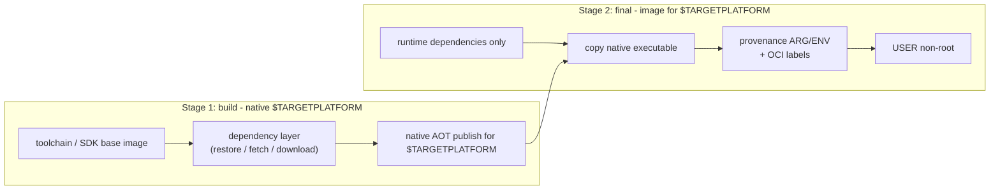
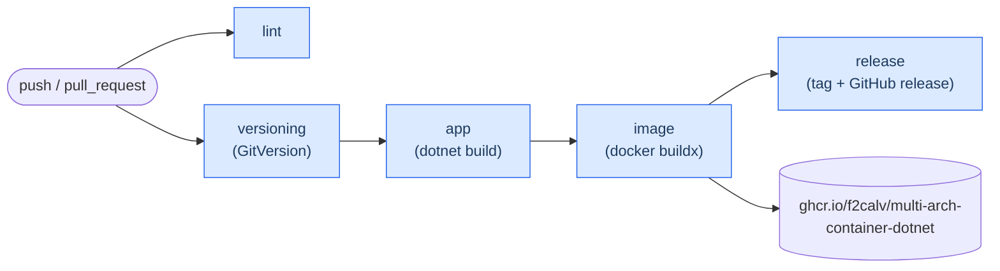

# Multi-Architecture Container Image w/.NET

Building a .NET Native AOT application container image for `linux/amd64` and `linux/arm64`
from a single [Dockerfile](Dockerfile). Parallel native builds are combined into one image index.

This checkout is an AOT pilot. Its CI temporarily calls the shared workflow's feature branch;
feature-branch validation does not publish images or releases. ARMv7 is not supported by this
Dockerfile, while the other language examples retain their own platform strategies.

If you find this repository useful then give it a :star: ... :wink:

## Introduction

I've been developing a service orientated smart home system which consists of a number of containerised workloads running on an edge Kubernetes cluster (via [k3s](https://k3s.io/)), the "cluster" comprises two Raspberry Pi 4b (ARMv8).

As well as running multiple workloads on the Pi 4b I also run workloads on another Raspberry Pi 2b (ARMv7) which is much older (but very power efficient). And finally I also need to run general tests of the workloads on my local Windows development machine prior to deployment to my "Production cluster", and at a later date I may even want to run these workloads on [Azure Kubernetes Service](https://azure.microsoft.com/en-us/products/kubernetes-service/).

Although I could achieve my goal of deploying the same application to multiple architectures using separate Dockerfiles (i.e. Dockerfile.amd64, Dockerfile.arm64, etc...) in my view that is messy and makes the CI/CD more complex. I think the single Dockerfile is the elegant approach keeping all build instructions in one place.

## Sibling Repositories

The same trivial worker application is implemented four times, once per language. The repository layout, file names, CI workflow and even the Dockerfile comments are kept as close to identical as possible - so a developer fluent in one language can learn another language's containerisation story simply by diffing two repositories.

| Repository | Language | Build image | Final image | Build strategy |
| --- | --- | --- | --- | --- |
| [multi-arch-container-dotnet](https://github.com/f2calv/multi-arch-container-dotnet) | C# / .NET 10 | `mcr.microsoft.com/dotnet/sdk:10.0-noble-aot` | `mcr.microsoft.com/dotnet/runtime-deps:10.0-noble-chiseled-extra` | Target-native AOT publish and image-index assembly |
| [multi-arch-container-go](https://github.com/f2calv/multi-arch-container-go) | Go | `golang:1-trixie` | `gcr.io/distroless/static-debian13:nonroot` | `GOOS` / `GOARCH` / `GOARM` |
| [multi-arch-container-rust](https://github.com/f2calv/multi-arch-container-rust) | Rust | `rust:1-trixie` | `gcr.io/distroless/cc-debian13:nonroot` | `rustup target` + GNU cross linker |
| [multi-arch-container-python](https://github.com/f2calv/multi-arch-container-python) | Python 3.14 | `python:3.14-slim-trixie` | `python:3.14-slim-trixie` | Architecture-neutral wheel + target-native runtime |

These repositories are **application code only** - Kubernetes packaging lives in the standalone [f2calv/helm-charts](https://github.com/f2calv/helm-charts) repository, which provides a single multi-purpose chart used by all four.

## Goals

- Construct a .NET multi-architecture container image via a single Dockerfile using the `docker buildx` command.
- Demonstrate idiomatic **structured logging** and **layered configuration** in each language, wired identically.
- Create a single GitHub Actions workflow [ci.yml](.github/workflows/ci.yml) to handle all tasks and host the reusable workflows in an external [gha-workflows](https://github.com/f2calv/gha-workflows) repository.

  - Auto-Semantic Versioning
  - Build App
  - Build Container + Push To GitHub Packages
  - GitHub Release

## Project Structure

- `docker-compose.yml` - builds and runs all four sibling images together, see [Run All Four Side By Side](#run-all-four-side-by-side).
- `src/multi-arch-container-dotnet/` - console application source.
  - `Program.cs` - entry point; configuration, logging and DI wiring only.
  - `Models/_AppConfig.cs` - application configuration bound from the `app` section.
  - `Models/_BuildInfo.cs` - build provenance bound from the flat `GIT_*`/`GITHUB_*` variables.
  - `Models/AppConfigValidator.cs` - generated configuration validation.
  - `Models/LoggingLevelConfig.cs` - source-bindable logging thresholds.
  - `Models/_Enums.cs` - all enums for the project.
  - `Services/SerilogLevelService.cs` - reloadable logging switches without assembly discovery.
  - `Services/WorkerService.cs` - the `BackgroundService` worker loop.
  - `appsettings.json` - base configuration.
- `Dockerfile` - two-stage, target-native AOT build with no managed runtime in the final image.
- `.github/workflows/ci.yml` - CI/CD using reusable workflows from [f2calv/gha-workflows](https://github.com/f2calv/gha-workflows).
- `build.sh` / `build.ps1` - local build scripts for manual testing.
- `Directory.Build.props` / `Directory.Packages.props` - central MSBuild properties and NuGet versions.

## Technology Stack

- **Language**: C# 14 / .NET 10.0
- **Hosting**: `Microsoft.Extensions.Hosting` generic host, `BackgroundService` worker
- **Logging**: Serilog owns the `Microsoft.Extensions.Logging` pipeline; application code depends only on `ILogger<T>`
- **Configuration**: `Microsoft.Extensions.Configuration` (`appsettings.json`, then environment variables), bound to validated `IOptions<T>` records
- **Container**: Docker (multi-stage, chiseled Ubuntu final image, non-root)
- **CI/CD**: GitHub Actions (reusable workflows from [f2calv/gha-workflows](https://github.com/f2calv/gha-workflows))
- **Versioning**: GitVersion (MainLine mode)

## Platform Mapping

RID is short for [Runtime Identifier](https://learn.microsoft.com/dotnet/core/rid-catalog). `docker buildx` injects `TARGETARCH` and `TARGETVARIANT` into the build, and the Dockerfile maps them onto a RID:

| Docker platform | `TARGETARCH` | `TARGETVARIANT` | .NET RID | Typical hardware |
| --- | --- | --- | --- | --- |
| `linux/amd64` | `amd64` | *(empty)* | `linux-x64` | Most desktop/server distributions |
| `linux/arm64` | `arm64` | *(empty)* | `linux-arm64` | Raspberry Pi 3+ on 64-bit Ubuntu/Debian, Apple Silicon, AWS Graviton |

The Dockerfile rejects a mismatch between `BUILDPLATFORM` and `TARGETPLATFORM`. Its CI caller
maps amd64 and arm64 to separate hosted native runners. Native AOT can also cross-compile with
an appropriate target toolchain; this pilot deliberately chooses native compilation instead.

## Anatomy of the Dockerfile

All four sibling repositories share the same two-stage shape:



The five ideas worth stealing:

1. Compile on matching native builders. The build platform guard fails instead of silently
  emulating an unsupported cross-architecture build.
2. Split dependency resolution from compilation. Project files, central properties and
  `global.json` form the restore layer; each target restores its own RID and AOT settings.
3. Publish offline with the same TFM, RID and feature switches used for restore.
4. Use BuildKit cache mounts without assuming they persist on newly provisioned runners.
  CI also uses separate per-platform layer cache scopes.
5. Ship runtime dependencies without the managed runtime. The non-root chiseled-extra image
  retains normal globalization and time-zone support.

The [CI caller](.github/workflows/ci.yml) smoke-runs both architectures with read-only filesystems,
no networking and JSON logs. It checks environment overrides, process architecture, version
provenance and graceful shutdown. The shared workflow then transfers platform archives and
verifies a combined OCI index in a disposable registry when publication is disabled.
See the [shared container architecture guide](https://github.com/f2calv/gha-workflows/blob/f2calv/2026-11-updates2/docs/architecture-container-images.md)
for the build and artifact hand-offs; this guide requires the unreleased feature-branch implementation.

## Logging

Structured logging is provided by [Serilog](https://serilog.net/), which takes ownership of the `Microsoft.Extensions.Logging` pipeline. Application code therefore only ever depends on `ILogger<T>` - Serilog could be swapped out without touching a single service.

```csharp
logger.LogInformation("{ClassName} git provenance, Repository={GitRepository} Branch={GitBranch}",
    nameof(WorkerService), buildInfo.Value.GitRepository, buildInfo.Value.GitBranch);
```

The equivalent in the sibling repositories:

| | .NET | Go | Rust | Python |
| --- | --- | --- | --- | --- |
| Library | Serilog (behind `ILogger<T>`) | `log/slog` (standard library) | `tracing` + `tracing-subscriber` | `logging` (standard library) |
| Text/JSON switch | `app:log_format` | `app.log_format` | `app.log_format` | `app.log_format` |
| Verbosity | `Serilog:MinimumLevel` in `appsettings.json` | `LOG_LEVEL` env var | `RUST_LOG` env var | `LOG_LEVEL` env var |

Set `APP__LOG_FORMAT=json` to emit newline-delimited JSON instead of human-readable console output:

```bash
docker run --rm -e APP__LOG_FORMAT=json ghcr.io/f2calv/multi-arch-container-dotnet
```

### OpenTelemetry

Set `OTEL_EXPORTER_OTLP_ENDPOINT` to enable batched logs, metrics and traces over OTLP/HTTP with Protocol Buffers. Serilog console logging remains enabled in the selected text or JSON format. The worker emits a `worker.iteration` span and increments the `worker.iterations` counter on every cycle.

```bash
docker run --rm \
  -e OTEL_EXPORTER_OTLP_ENDPOINT=http://otel-collector:4318 \
  -e OTEL_SERVICE_NAME=multi-arch-container-dotnet \
  -e OTEL_RESOURCE_ATTRIBUTES=deployment.environment.name=development \
  ghcr.io/f2calv/multi-arch-container-dotnet
```

The exporter honors signal-specific `OTEL_EXPORTER_OTLP_*` variables for endpoints, headers, compression, certificates and timeouts. When the base endpoint is absent, no OpenTelemetry provider or exporter is initialized.

## Configuration

Configuration is layered by [Microsoft.Extensions.Configuration](https://learn.microsoft.com/dotnet/core/extensions/configuration), in ascending order of precedence:

1. Property defaults on the `AppConfig` record.
2. [`appsettings.json`](src/multi-arch-container-dotnet/appsettings.json).
3. An optional `appsettings.${DOTNET_ENVIRONMENT}.json` file.
4. Environment variables.
5. Command line arguments.

Step 3 is the one place where this repository intentionally has a capability its siblings lack. `Host.CreateApplicationBuilder` provides it for free, keyed off the host's own `DOTNET_ENVIRONMENT` variable, so removing it would mean fighting the framework. Reimplementing it in Go, Rust and Python would mean hand-rolling file resolution and merge semantics in three languages to match a built-in, which is not a trade worth making in a reference repository.

Values are bound to validated `IOptions<T>` records with `ValidateDataAnnotations().ValidateOnStart()`, so a bad value fails fast at startup rather than surfacing later.

| Key | Environment variable | Default | Description |
| --- | --- | --- | --- |
| `app:greeting` | `APP__GREETING` | `Hello from a multi-architecture container` | Message logged each iteration |
| `app:interval_seconds` | `APP__INTERVAL_SECONDS` | `3` | Delay between iterations, from 1 to 3600 seconds |
| `app:log_format` | `APP__LOG_FORMAT` | `text` | `text` or `json` |

Keys are **snake_case**, not PascalCase, and mapped onto idiomatic C# property names with `[ConfigurationKeyName]`. That is deliberate: the Go and Rust configuration libraries lower-case environment keys, so snake_case is the only casing where the file key and the environment key resolve identically across all four languages.

Build provenance is a second, flat set of variables baked into the image by the `ARG`/`ENV` block of the [Dockerfile](Dockerfile) (populated by CI, or by `build.sh`/`build.ps1` locally). The same names are used by all four sibling repositories.

| Environment Variable | Description |
| --- | --- |
| `GIT_REPOSITORY` | Git repository name |
| `GIT_BRANCH` | Git branch name |
| `GIT_COMMIT` | Git commit SHA |
| `GIT_TAG` | Git tag |
| `GITHUB_WORKFLOW` | GitHub Actions workflow name |
| `GITHUB_RUN_ID` | GitHub Actions run ID |
| `GITHUB_RUN_NUMBER` | GitHub Actions run number |

## Run Pre-Built Container Image

```bash
#Run pre-built image on Docker
docker run --pull always --rm -it ghcr.io/f2calv/multi-arch-container-dotnet

#Override configuration at runtime
docker run --pull always --rm -it -e APP__GREETING="hello world" -e APP__INTERVAL_SECONDS=1 ghcr.io/f2calv/multi-arch-container-dotnet

#Inspect the multi-architecture manifest list
docker buildx imagetools inspect ghcr.io/f2calv/multi-arch-container-dotnet
```

## Run on Kubernetes with Helm

The public [universal `workload` chart](https://github.com/f2calv/helm-charts/tree/main/charts/workload) deploys this .NET worker through the same framework-neutral values used for Go, Rust, and other containerised runtimes. Sensible defaults keep the worker configuration small while retaining opt-in access to scheduling, networking, storage, autoscaling, and disruption controls.

Create `multi-arch-container-dotnet.values.yaml` with the pinned image and worker configuration:

```yaml
kind: Deployment
replicaCount: 1

fullnameOverride: multi-arch-container-dotnet

image:
  repository: ghcr.io/f2calv/multi-arch-container-dotnet
  tag: 1.3.1
  pullPolicy: IfNotPresent

service:
  enabled: false

startupProbe: false
readinessProbe: false
livenessProbe: false

envVars:
  APP__GREETING: Hello from .NET on Kubernetes
  APP__INTERVAL_SECONDS: "5"
  APP__LOG_FORMAT: json
```

Install or upgrade the Deployment with version `1.1.0` of the universal `workload` chart:

```bash
helm upgrade --install multi-arch-container-dotnet oci://ghcr.io/f2calv/charts/workload \
  --version 1.1.0 \
  --values multi-arch-container-dotnet.values.yaml

kubectl logs --follow deployment/multi-arch-container-dotnet
helm uninstall multi-arch-container-dotnet
```

## Self-Build Container Image Locally

The .NET workload is an ultra simple worker process (i.e. a console application) which loops outputting a number of environment variables passed in during the CI process and then baked into the container image.

Select a Buildx builder native to the requested target. For a local amd64 smoke image:

```bash
docker buildx build --platform linux/amd64 --load --tag worker:aot-local .
```

Use `linux/arm64` on a native ARM64 builder. A configured multi-node native builder can export
both targets with `--platform linux/amd64,linux/arm64 --output type=oci,dest=worker.tar`.
An alternate restore feed can be supplied through the optional BuildKit secret `nuget_source`,
without editing NuGet configuration or disabling certificate validation.

The root build shims remain unchanged in this pilot; their native-builder forwarding and the
four-language Compose build are not covered by the hosted CI checks. Do not assume the old
three-platform local path is compatible with this Dockerfile.

## Build & Test Commands

A [devcontainer](.devcontainer/devcontainer.json) is provided so the repository can be built without installing the .NET SDK on the host; installing the SDK natively (Visual Studio 2026 / `dotnet` CLI) works equally well.

```bash
# Restore, build and run
dotnet restore
dotnet build
dotnet run --project src/multi-arch-container-dotnet

# Format check
dotnet format --verify-no-changes
```

## Run All Four Side By Side

This repository carries a [docker-compose.yml](docker-compose.yml) that builds and runs **all four** sibling images together, which is the quickest way to confirm that configuration, environment variables and log output behave identically across the languages. It expects the siblings to be cloned alongside this repository:

```text
source/github/
├── multi-arch-container-dotnet/   <- docker-compose.yml lives here
├── multi-arch-container-go/
├── multi-arch-container-rust/
└── multi-arch-container-python/
```

```bash
# Build all four in parallel, then run them together
docker compose up --build

# Same, but with real git provenance baked in and JSON logging
GIT_COMMIT=$(git rev-parse HEAD) APP__LOG_FORMAT=json docker compose up --build

# Prove the configuration override reaches all four identically
APP__GREETING="hello from compose" APP__INTERVAL_SECONDS=1 docker compose up --build

docker compose down
```

Build provenance (`GIT_*`, `GITHUB_*`) is passed as **build args** and baked into each image, so changing one needs `--build`. Application configuration (`APP__*`) is passed as **runtime environment**, so it takes effect on the next `up`.

The `telemetry` profile adds an [OpenTelemetry Collector](.docker/otel-collector.yaml) so the OTLP output of all four can be compared too. It prints every log, metric and trace it receives to its own stdout:

```bash
OTEL_EXPORTER_OTLP_ENDPOINT=http://otel-collector:4318 docker compose --profile telemetry up --build

docker compose logs -f otel-collector
```

Without `OTEL_EXPORTER_OTLP_ENDPOINT` the collector is not started and none of the four initialises an OpenTelemetry provider, which is the default path.

## Deployment Flow



## Docker, Container & .NET Resources

- I highly recommend reading the official Docker blog posts about multi-arch images;

  - <https://www.docker.com/blog/multi-arch-images/>
  - <https://www.docker.com/blog/multi-arch-build-and-images-the-simple-way/>
  - <https://www.docker.com/blog/faster-multi-platform-builds-dockerfile-cross-compilation-guide/>

- Official Docker documentation about support/implementation for multi-arch images;

  - <https://docs.docker.com/build/building/multi-platform/>
  - <https://docs.docker.com/build/builders/>
  - <https://docs.docker.com/reference/cli/docker/buildx/build/>
  - <https://docs.docker.com/build/cache/optimize/>

- Official Microsoft documentation useful for multi-arch .NET application builds;

  - <https://learn.microsoft.com/dotnet/core/rid-catalog>
  - <https://learn.microsoft.com/dotnet/core/tools/dotnet-publish>
  - <https://learn.microsoft.com/dotnet/core/docker/container-images>
  - <https://learn.microsoft.com/dotnet/core/extensions/configuration>

## Further Resources

- [Click here for the Go version of this repository...](https://github.com/f2calv/multi-arch-container-go)
- [Click here for the Rust version of this repository...](https://github.com/f2calv/multi-arch-container-rust)
- [Click here for the Python version of this repository...](https://github.com/f2calv/multi-arch-container-python)
- [Click here for the Helm chart used to deploy all four...](https://github.com/f2calv/helm-charts)
